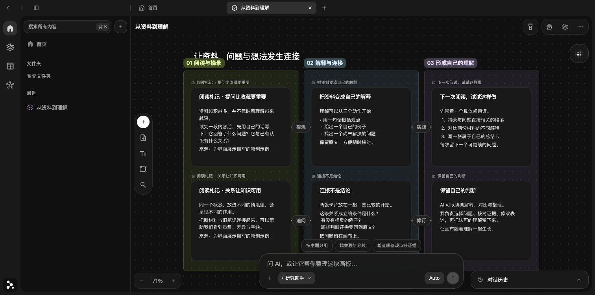
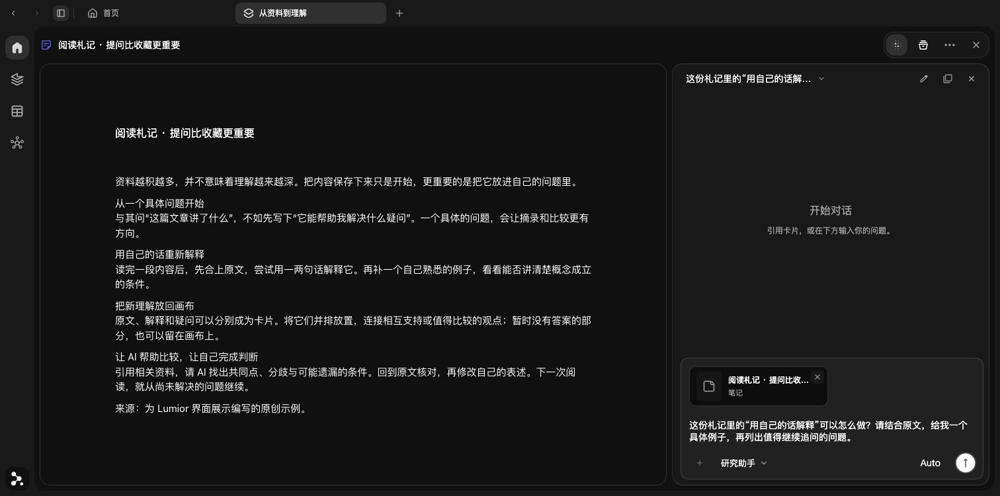
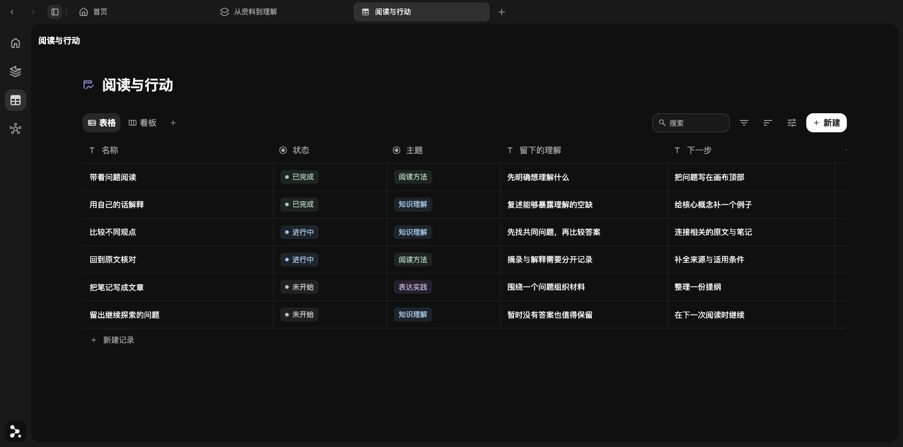

# Lumior

[中文](README.md) · [Download the desktop app](https://lumior.work/) · [Try the web demo](https://demo.lumior.work/) · [Report an issue](https://github.com/limanman-design/lumior-community/issues)

**Read papers, organize evidence, and take research notes on one whiteboard.**

Lumior is a local-first research workspace. Put PDFs, excerpts, and notes on the same whiteboard, then arrange them with cards, links, and sections. Translate a difficult passage in place or ask AI about selected sources, check the citations, and save useful answers as notes.

## New on desktop: Offline PDF translation

- **Translate a selection.** Select a sentence or passage in a PDF, then copy the translation or save it as an annotation.
- **Translate a whole PDF side by side.** Read the original and translation with matching page sizes and synchronized scrolling. Pause and resume, export a separate PDF, and preserve formulas that can be located reliably as images from the source.
- **Download once, then translate offline.** Get the model and runtime (about 1.15 GB total) under Settings → AI Services → Local Translation. Local translation requires neither an API key nor cloud credits.

The official desktop releases are `0.1.43` for Apple silicon Macs and `0.1.43-win.1` for the Windows x64 preview. Local translation has been tested on an Apple silicon Mac. Testing on Windows hardware is pending. The web demo lets you explore whiteboards and sample material. [Download the desktop app](https://lumior.work/) · [Local translation guide (Chinese)](docs/LOCAL-TRANSLATION.md)

## From reading to research notes

1. **Read and annotate.** Highlight a PDF and bring key excerpts onto the whiteboard alongside the source.
2. **Organize and compare.** Lay out documents, images, videos, and excerpts. Connect related ideas and group evidence into sections.
3. **Ask about your sources.** Select cards, ask AI a question, and follow citations back to the original material.
4. **Keep the results.** Save useful answers or excerpts as editable notes. Track topics, reading progress, and next steps in databases.

## A look inside

These screenshots use the current interface and purpose-written sample material. The AI prompt is an unsent demonstration draft with no model call; no private workspace is shown.



*Keep sources together and explore their relationships through connections and sections.*



*Reference relevant cards and prepare a question in the context of the original material.*



*Organize reading status, topics and next actions in a database.*

## Community source

Workspaces are stored locally. Local features work without an official account. Obsidian folder imports support per-note storage, on-demand reading, wiki-link navigation, resumable imports, and directory backups. MBA assistant skills and templates are included in the source.

Community builds use your own API key for cloud AI by default. When you start a cloud request, the app sends the context it needs to the selected provider. Lumior's official hosted AI is operated separately, and community builds come without official model credits. Community source and official installers are released separately. [AI and data](docs/AI-DATA.md) · [Source scope and known limitations](docs/OPEN-SOURCE-STATUS.md)

## Development

Use Node.js 24 and pnpm 11.25.0:

```sh
pnpm install --frozen-lockfile
pnpm dev --port 3001
```

Open `http://localhost:3001`. Browser data belongs to that browser and origin; back up before clearing it.

For desktop development:

```sh
pnpm --dir desktop install --frozen-lockfile
node desktop/node_modules/electron/install.js
pnpm desktop:dev
```

To prepare an unsigned community build:

```sh
pnpm build
pnpm desktop:build
pnpm --dir desktop pack
```

Community builds have a separate application identity and data directory, with official automatic updates disabled. See [development](docs/DEVELOPMENT.md) and [contributing](CONTRIBUTING.md).

## Open-source acknowledgments

Thank you to these projects and their contributors:

| Project | Role in Lumior | License |
| --- | --- | --- |
| [BlockNote](https://github.com/TypeCellOS/BlockNote) | Block-based rich-text editing inside note cards | MPL-2.0 |
| [Ocean DataView](https://github.com/jingerpie/ocean-dataview) | Adapted table, list, gallery-card, board and view-settings components | MIT |
| [PDF.js](https://github.com/mozilla/pdf.js) | PDF reading and rendering | Apache-2.0; bundled resources retain their own notices |

Lumior integrates canvas organization, connections, sections and AI workflows. Its database uses selected Ocean DataView components with local persistence, editing and view management. Naming these projects does not imply endorsement.

Original Lumior code is Apache-2.0. Third-party code keeps its own license. See [NOTICE](NOTICE.md) for sources, versions and modifications, and [pnpm-lock.yaml](pnpm-lock.yaml) for dependency versions.

Please report security issues through [SECURITY](SECURITY.md).
