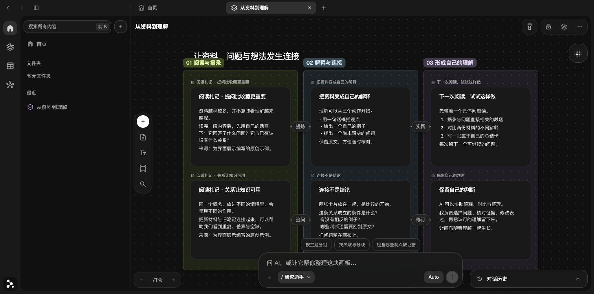
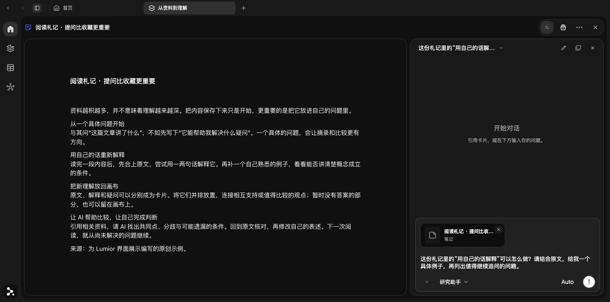
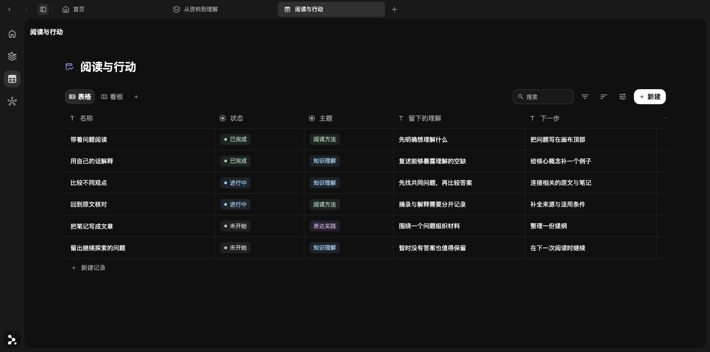

# Lumior

[English](README.en.md) · [下载桌面版](https://lumior.work/) · [试用网页演示](https://demo.lumior.work/) · [反馈问题](https://github.com/limanman-design/lumior-community/issues)

**用一张画板读论文、整理证据、写研究笔记。**

Lumior 是一个本地优先的研究工作区。把 PDF、摘录和笔记放在同一张画板上，用卡片、连线和分区梳理关系。读到难懂的段落，可以就地翻译，也可以选中资料向 AI 提问，核对引用后把有用的回答留作笔记。

## 桌面新版：离线 PDF 翻译

- **拖选翻译。** 在 PDF 中选一句或一段，译文可复制，也可保存为标注。
- **整篇对照翻译。** 原文和译文左右并排，页面同尺寸、按页同步滚动。支持暂停续译、另存为 PDF，并保留能可靠定位的公式原图。
- **下载一次，之后可离线使用。** 在「设置 → AI 服务 → 本地翻译」下载模型和运行组件，合计约 1.15 GB。本地翻译无需 API Key，也不消耗云端额度。

官方桌面版已发布 Mac Apple 芯片版 `0.1.43` 和 Windows x64 预览版 `0.1.43-win.1`。本地翻译已在 Apple 芯片 Mac 上实测，Windows 实机验证待补。网页演示适合体验画板和示例资料。 [下载桌面版](https://lumior.work/) · [本地翻译使用说明](docs/LOCAL-TRANSLATION.md)

## 从阅读到研究笔记

1. **阅读和摘录。** 打开 PDF 做高亮、批注，把重要段落留在画板上，和原文对照。
2. **整理和比较。** 把文档、图片、视频和摘录摆在一起，用连线和分区比较观点、整理证据。
3. **围绕资料提问。** 选中几张卡片问 AI，点击回答中的引用回查原文。
4. **留下研究结果。** 把有用的回答或选段存为可编辑笔记，用多维表跟踪主题、阅读进度和下一步。

## 界面一览



*把资料放到同一张画布，用连线与分区梳理关系。*



*阅读原文时引用相关卡片，准备一个有具体上下文的问题。*



*用多维表维护阅读进度、主题和下一步行动。*

## 社区源码

工作区保存在本机，无需官方账号即可使用本地功能。可导入 Obsidian 文件夹，原文逐篇保存，支持按需读取、双链跳转、续传与目录备份。MBA 助手的 Skill 和模板随源码提供。

社区构建默认用个人 API Key 访问云端 AI。主动发起云端请求时，完成该功能所需的内容会发送给所选供应商。官方托管 AI 服务单独运营，社区构建不附带官方额度。社区源码和官方安装包分别发布。 [AI 与数据](docs/AI-DATA.md) · [源码范围与已知限制](docs/OPEN-SOURCE-STATUS.md)

## 从源码运行

需要 Node.js 24 和 pnpm 11.25.0。在项目根目录运行：

```sh
pnpm install --frozen-lockfile
pnpm dev --port 3001
```

打开 `http://localhost:3001`。网页数据属于当前浏览器与网址，清理浏览器数据前请备份。

桌面开发：

```sh
pnpm --dir desktop install --frozen-lockfile
node desktop/node_modules/electron/install.js
pnpm desktop:dev
```

社区生产构建：

```sh
pnpm build
pnpm desktop:build
pnpm --dir desktop pack
```

社区版使用独立身份和数据目录，不连接官方自动更新。不要把正式工作区目录手动配置给开发版。更多说明见 [开发指南](docs/DEVELOPMENT.md)。

## 贡献

欢迎修复问题、完善文档、改进中英文表达，以及提供合成数据下的性能复现。开始较大功能前先讨论范围。提交前阅读 [贡献指南](CONTRIBUTING.md)、[AI 入口要求](docs/AI-ENTRY-ACCEPTANCE.md) 和 [界面规范](docs/UI-DESIGN-SYSTEM.md)。

```sh
pnpm colors:check
node node_modules/typescript/bin/tsc --noEmit --incremental false
pnpm test:public
pnpm build
```

## 开源致谢与许可

Lumior 建立在开源社区的工作之上，感谢这些项目及其贡献者：

| 项目 | 在 Lumior 中的用途 | 许可 |
| --- | --- | --- |
| [BlockNote](https://github.com/TypeCellOS/BlockNote) | 笔记卡片内部的块编辑与富文本编辑器 | MPL-2.0 |
| [Ocean DataView](https://github.com/jingerpie/ocean-dataview) | 多维表的表格、列表、画廊卡片、看板及部分视图设置组件，经本地适配 | MIT |
| [PDF.js](https://github.com/mozilla/pdf.js) | PDF 阅读与渲染 | Apache-2.0，附带资源以各自声明为准 |

画布上的卡片组织、连线、分区和 AI 工作流由 Lumior 集成实现。多维表使用了 Ocean DataView 的部分组件，本地数据存储、编辑与视图管理由 Lumior 实现。上述项目的名称不代表对 Lumior 的官方背书。

Lumior 原创代码采用 Apache-2.0；第三方代码继续遵循各自许可。完整的来源、版本与修改说明见 [NOTICE](NOTICE.md)，依赖版本见 [pnpm-lock.yaml](pnpm-lock.yaml)。

安全问题请使用 [私密报告渠道](SECURITY.md)。
