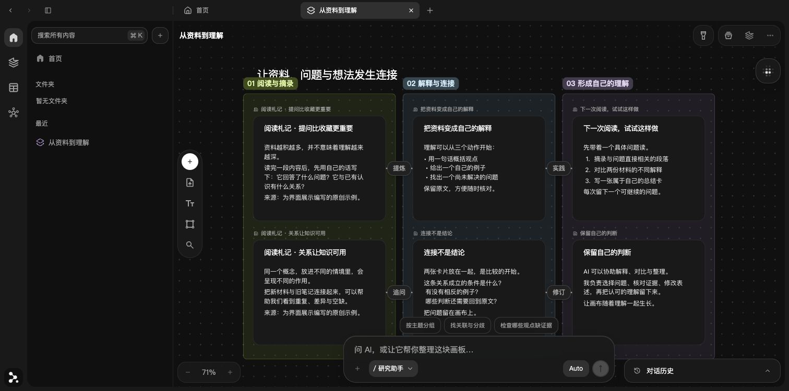
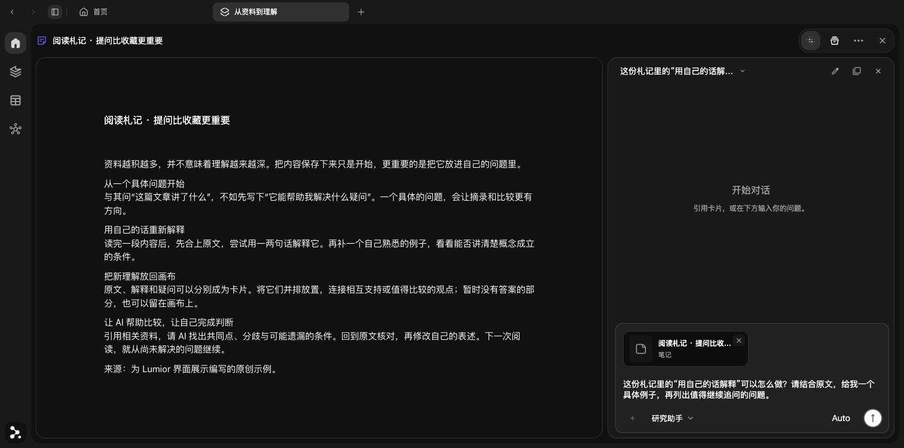
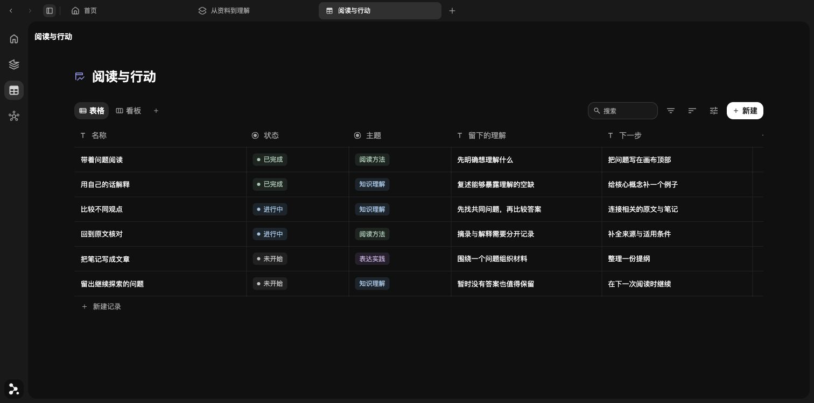

# Lumior

[English](README.en.md) · [官网 / Downloads](https://lumior.work/) · [在线演示](https://demo.lumior.work/) · [反馈问题](https://github.com/limanman-design/lumior-community/issues)

**让智能画布与知识理解一起工作。**

Lumior 是一个本地优先的知识工作区，关注资料、理解与表达之间的连接。你可以把原文、摘录和想法放在同一张画布上，通过卡片、连线与分区梳理关系；再让 AI 围绕这些资料查找证据、解释概念、比较观点，并把整理结果变成可以继续编辑的卡片。

画布为理解提供上下文，理解也不断改变画布上的组织方式。从阅读一个问题，到建立自己的知识结构，资料与思考可以留在同一个工作空间里持续积累。

项目采用 [Apache-2.0](LICENSE)，第三方组件保留各自许可；源码范围与已知限制见 [项目状态](docs/OPEN-SOURCE-STATUS.md)。源码与官方安装包分别发布，下载版本请以官网为准。

## 从资料到理解，再回到画布

1. **把资料放在一起。** 导入文档、PDF、图片或视频，把原文与自己的笔记并排展开。
2. **让关系看得见。** 摘录、连接、分组，在空间中比较不同观点，发现还需要补充的证据。
3. **围绕资料与 AI 协作。** 针对选中的卡片或画板提问，阅读带来源的回答，再回到原文核对。
4. **把理解留下来。** 将结果整理为可编辑卡片，继续连接与修订；也可以用多维表管理阅读记录和后续行动。

## 界面一览



*把资料放到同一张画布，用连线与分区梳理关系。*



*阅读原文时引用相关卡片，准备一个有具体上下文的问题。*



*用多维表维护阅读进度、主题和下一步行动。*

## 主要能力

- 用画板、笔记、PDF 批注、图片、视频和多维表组织资料。
- 导入 Obsidian 文件夹：原文逐篇保存，打开时读取，支持双链跳转、中断续传与文件夹备份。
- 使用自己的模型 API Key 对话、翻译和研究；MBA 助手的原始 Skill 和模板随源码提供。
- 在本机保存工作区；无需官方账号即可使用本地功能。

开源代码不附赠模型额度。官方托管 AI 服务独立运营，可以收费；社区构建默认使用个人 Key。AI 只会在用户主动发起相关操作时按功能需要发送内容，详见 [AI 与数据](docs/AI-DATA.md)。

## 从源码运行

需要 Node.js 24 和 pnpm 11.25.0。在项目根目录运行：

```sh
pnpm install --frozen-lockfile
pnpm dev --port 3001
```

打开 `http://localhost:3001`。网页数据属于当前浏览器与网址，清理浏览器数据前请备份。

桌面开发：

```sh
pnpm --dir desktop install --frozen-lockfile
node desktop/node_modules/electron/install.js
pnpm desktop:dev
```

社区生产构建：

```sh
pnpm build
pnpm desktop:build
pnpm --dir desktop pack
```

社区版使用独立身份和数据目录，不连接官方自动更新。不要把正式工作区目录手动配置给开发版。更多说明见 [开发指南](docs/DEVELOPMENT.md)。

## 贡献

欢迎修复问题、完善文档、改进中英文表达，以及提供合成数据下的性能复现。开始较大功能前先讨论范围。提交前阅读 [贡献指南](CONTRIBUTING.md)、[AI 入口要求](docs/AI-ENTRY-ACCEPTANCE.md) 和 [界面规范](docs/UI-DESIGN-SYSTEM.md)。

```sh
pnpm colors:check
node node_modules/typescript/bin/tsc --noEmit --incremental false
pnpm test:public
pnpm build
```

## 开源致谢与许可

Lumior 建立在开源社区的工作之上，感谢这些项目及其贡献者：

| 项目 | 在 Lumior 中的用途 | 许可 |
| --- | --- | --- |
| [BlockNote](https://github.com/TypeCellOS/BlockNote) | 笔记卡片内部的块编辑与富文本编辑器 | MPL-2.0 |
| [Ocean DataView](https://github.com/jingerpie/ocean-dataview) | 多维表的表格、列表、画廊卡片、看板及部分视图设置组件，经本地适配 | MIT |
| [PDF.js](https://github.com/mozilla/pdf.js) | PDF 阅读与渲染 | Apache-2.0，附带资源以各自声明为准 |

画布上的卡片组织、连线、分区和 AI 工作流由 Lumior 集成实现。多维表使用了 Ocean DataView 的部分组件，本地数据存储、编辑与视图管理由 Lumior 实现。上述项目的名称不代表对 Lumior 的官方背书。

Lumior 原创代码采用 Apache-2.0；第三方代码继续遵循各自许可。完整的来源、版本与修改说明见 [NOTICE](NOTICE.md)，依赖版本见 [pnpm-lock.yaml](pnpm-lock.yaml)。

安全问题请使用 [私密报告渠道](SECURITY.md)。
